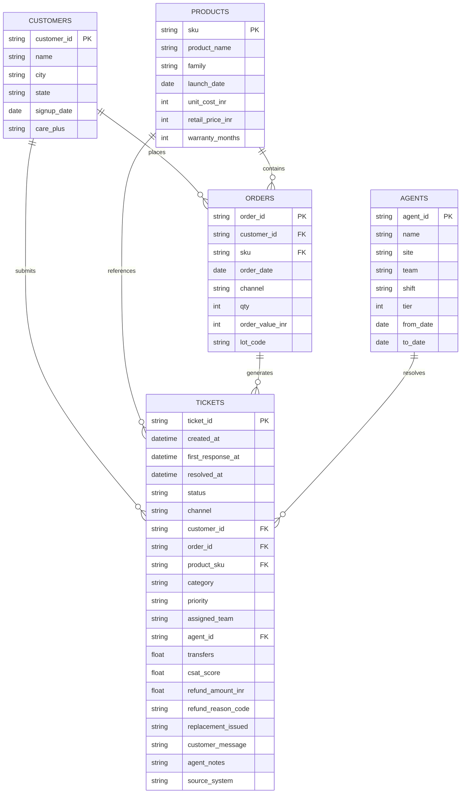

# Technical & Business Analysis: Vireo Audio Support Operations Assessment

**Author:** Senior Data Analyst & AI Engineer  
**Date:** October 7, 2026  
**Project:** Vireo Audio — Customer Support Desk Diagnostic & Headcount Case  
**Target File Location:** `/Users/gurnoorkhurana/.gemini/antigravity-ide/scratch/vireo_audio/ANALYSIS.md`

---

## Executive Summary & Diagnostic Premise

This document provides a comprehensive pre-implementation analysis of the Vireo Audio support dataset, operating policy, and stakeholder communications. 

The primary business dispute involves a proposed **₹9,00,000/year investment** for 2 additional headcount currently earmarked for the **Billing** team based solely on raw ticket intake volume. 

Our initial data diagnostic reveals that:
1. **The Billing queue is artificially inflated:** ~33.5% of tickets routed to Billing do not belong there and are transferred to or resolved by other teams (predominantly Logistics and Returns Desk).
2. **Logistics is facing severe operational strain:** Despite having only 5 agents compared to Billing's 4, Logistics resolves **45% more tickets** than Billing (2,673 vs. 1,838), has an average resolution time of **42.5 hours** (median 26.1 hours; 60% taking >24h), suffers the lowest CSAT across the company (**2.87 / 5.0**), and receives the highest number of transferred tickets.
3. **Financial leakage exceeds ₹15–20 Lakh:** Identifiable process failures include ₹4.69 Lakh in SLA breach credits, ₹3.96 Lakh in internal transfer handling waste, ₹3.95 Lakh in double-dipping violations (orders receiving both refunds and replacements), and ₹8.75 Lakh in repeat contacts.

---

## 1. What the Client is Actually Asking For (Technical & Business Requirements)

### The Stated Request (Surface Level)
- **Stakeholder:** Priya Raman (Head of Customer Experience).
- **Deliverable Requested:** Monthly ticket volume broken down by `category` and `assigned_team`.
- **Intended Decision:** Justify hiring 2 new support agents into the "biggest team" (assumed to be Billing based on raw ticket intake of ~22%).

### The Real Business & Operational Dilemma
- **Stakeholder Conflict:**
  - **Arjun Mehta (Finance Controller):** Requires a defensible written case for the ₹9 Lakh/year expense. Emphasizes fixing broken processes/routing over hiring into inefficiency.
  - **Neha Kulkarni (Support Operations Manager):** Warns that Billing’s queue is bloated with misrouted tickets and asserts Logistics is the team actually drowning in volume, delays, and hand-offs.
  - **Sameer Qureshi (IT Admin):** Cautions that intake bot categorization is inaccurate and rarely corrected by human agents.
- **The Core Analytical Question:**  
  *Should Vireo hire 2 agents into Billing, hire 2 agents into Logistics, reallocate existing capacity, or deploy automated intake routing to eliminate waste without adding headcount?*

### Concrete Technical & Analytical Requirements
1. **Data Cleansing & Reconciliation:**
   - Resolve timezone inconsistencies (UTC vs. IST in `legacy_fd` resolution timestamps).
   - Reconcile agent display name collisions (`Om Sharma`) using `agent_id`.
   - Implement fallback joins (`customer_id` + `product_sku`) for orders with missing `order_id`.
2. **Volume & Workload Discrepancy Modeling:**
   - Compare `assigned_team` (first touch / bot intake) against actual resolving agent team (`agent_id` mapped to `team` in `agents.csv`).
   - Quantify misrouting rates and inter-team transfer volume.
3. **Process & Operational Bottleneck Analysis:**
   - Measure First-Response SLA breach rates and associated penalties per channel and team.
   - Analyze Total Resolution Time (Handle Time) across teams.
   - Evaluate Customer Satisfaction (CSAT) vs. transfers and handle time.
4. **Financial Opportunity & Leakage Quantification:**
   - Model the net financial impact in ₹ across staffing costs, transfer waste, SLA breach penalties, policy violations, and repeat contacts.
5. **AI/NLP Intake Feasibility:**
   - Characterize semantic mismatch between customer intent and bot category tags to establish the business case for intelligent classification.

---

## 2. File Contents & Entity Relationships

The data pack comprises 8 core files:



### File Breakdown:
1. `tickets.csv` (11,780 rows, 21 columns): Central fact table of support tickets between June 2024 and June 2026.
2. `agents.csv` (44 rows, 8 columns): Agent dimension table covering staffing roster, site location, team assignment, shift, and support tier.
3. `customers.csv` (9,500 rows, 6 columns): Customer demographic and subscription dimension table.
4. `orders.csv` (15,000 rows, 8 columns): E-commerce and retail transactions, including manufacturing batch `lot_code`.
5. `products.csv` (14 rows, 7 columns): Product catalog including unit cost, retail price, and warranty duration.
6. `support-policy.pdf` (2 pages, v3.2): Official operating policy defining SLAs, breach costs, transfer fees, labor rates, and refund/replacement rules.
7. `email-thread.txt` (64 lines): Internal stakeholder email exchange capturing organizational context, hypotheses, and political dynamics.
8. `README.txt` (42 lines): Official data dictionary and technical notes regarding system migration.

---

## 3. Important Columns and Data Types

| Dataset | Column Name | Data Type | Null Count | Description & Analytical Significance |
| :--- | :--- | :--- | :--- | :--- |
| **tickets** | `ticket_id` | `VARCHAR(16)` | 0 (0.0%) | Primary Key. Format `TK-24XXXX`. |
| **tickets** | `created_at` | `DATETIME` | 0 (0.0%) | Timestamp of intake (IST). |
| **tickets** | `first_response_at` | `DATETIME` | 0 (0.0%) | Timestamp of first human reply (IST). |
| **tickets** | `resolved_at` | `DATETIME` | 583 (4.9%) | Timestamp of resolution. **Note: UTC for `legacy_fd`, IST for `helpdesk`**. |
| **tickets** | `status` | `VARCHAR(16)` | 0 (0.0%) | Status: `resolved` (10,128), `closed` (1,069), `open` (336), `pending` (247). |
| **tickets** | `channel` | `VARCHAR(16)` | 0 (0.0%) | Intake channel: `chat` (5,387), `email` (3,555), `voice` (1,702), `social` (1,136). |
| **tickets** | `customer_id` | `VARCHAR(16)` | 0 (0.0%) | FK to `customers.csv`. 100% referential integrity. |
| **tickets** | `order_id` | `VARCHAR(16)` | 3,091 (26.2%)| FK to `orders.csv`. Missing in 26.2% of cases when not quoted by customer. |
| **tickets** | `product_sku` | `VARCHAR(16)` | 0 (0.0%) | FK to `products.csv`. 100% referential integrity. |
| **tickets** | `category` | `VARCHAR(32)` | 0 (0.0%) | Bot-assigned intake category tag (11 distinct values). |
| **tickets** | `assigned_team` | `VARCHAR(32)` | 0 (0.0%) | Initial team assigned by routing logic (1:1 with bot category or channel). |
| **tickets** | `agent_id` | `VARCHAR(16)` | 0 (0.0%) | FK to `agents.csv`. Resolving agent identifier. |
| **tickets** | `transfers` | `FLOAT` | 4,052 (34.4%)| Number of team hand-offs. Unrecorded in `legacy_fd` (blank). |
| **tickets** | `csat_score` | `FLOAT` | 6,435 (54.6%)| 1–5 customer satisfaction rating. Blank means non-response. |
| **tickets** | `refund_amount_inr` | `FLOAT` | 9,886 (83.9%)| Refund amount issued in INR. |
| **tickets** | `refund_reason_code`| `VARCHAR(16)` | 9,886 (83.9%)| Dropdown code from policy §5 (e.g., `RETURN-QC-OK`, `DUP-PAYMENT`). |
| **tickets** | `replacement_issued`| `CHAR(1)` | 0 (0.0%) | Flag: `Y` (1,102) or `N` (10,678). |
| **tickets** | `source_system` | `VARCHAR(16)` | 0 (0.0%) | `helpdesk` (7,728) or `legacy_fd` (4,052). |
| **agents** | `agent_id` | `VARCHAR(16)` | 0 (0.0%) | Primary Key. 44 agents total. |
| **agents** | `team` | `VARCHAR(32)` | 0 (0.0%) | Functional team: Chat (15), Email (7), Esc/Wty (6), Logistics (5), Voice (4), Billing (4), Returns (3). |
| **agents** | `tier` | `INT` | 0 (0.0%) | Tier 1 (38 agents) vs Tier 2 (6 agents in Escalations & Warranty). |
| **orders** | `order_value_inr` | `INT` | 0 (0.0%) | Total order transaction value in INR. |
| **orders** | `lot_code` | `VARCHAR(16)` | 0 (0.0%) | Manufacturing lot number (e.g., `PL1-2403-4`). |
| **products** | `unit_cost_inr` | `INT` | 0 (0.0%) | Landed cost to Vireo (used for replacement cost calculation). |
| **products** | `retail_price_inr`| `INT` | 0 (0.0%) | Standard selling price in INR. |

---

## 4. Data Quality Problems Discovered

### A. Timezone Discrepancy & Negative Handle Times (Critical)
- **The Issue:** In `legacy_fd` records (4,052 tickets prior to Sept 14, 2025), `resolved_at` timestamps produce **2,575 negative handle times** (e.g., -5.23 hours).
- **Root Cause Confirmed by Policy §9:** Migration reconstructed `resolved_at` from the legacy event log in **UTC**, whereas `created_at` and `first_response_at` were recorded in **IST** (UTC + 5:30).
- **Remediation:** For all rows where `source_system == 'legacy_fd'`, add exactly `+5 hours 30 minutes` to `resolved_at`. Post-adjustment, 0 negative handle times remain.

### B. Out-of-Scope Pre-2025 Tickets
- **The Issue:** README states data covers `1 Jan 2025 – 30 Jun 2026`. However, the dataset contains **139 tickets from June 2024 to December 2024**.
- **Observation:** All 139 tickets belong to `legacy_fd` and are assigned to `Billing`.
- **Analytical Consideration:** Analyses must account for whether these rows are included or filtered out, as their inclusion slightly shifts historical baseline comparisons.

### C. Agent Display Name Collisions
- **The Issue:** Two distinct agents share the identical name `Om Sharma`:
  - `A3006`: Indore, Chat Frontline, Tier 1.
  - `A3033`: Bengaluru, Logistics, Tier 1.
- **Remediation:** Any aggregation, join, or performance tracking must strictly use `agent_id`, never agent name.

### D. Missing `order_id` & Fallback Join
- **The Issue:** 3,091 tickets (26.2%) have a null `order_id` because customers did not supply it during intake.
- **Remediation:** Use the documented fallback join key: `customer_id` + `product_sku` against `orders.csv`.

### E. Missing Transfer Data in Legacy Tickets
- **The Issue:** All 4,052 legacy tickets have `transfers == NaN` because Freshdesk did not log transfer counts.
- **Analytical Consideration:** Transfer volume and transfer costs can only be directly calculated from the 7,728 `helpdesk` tickets (where 1,299 transfers are recorded). Any full-history extrapolation must clearly state that legacy transfer rates are estimated.

### F. CSAT Null Handling
- **The Issue:** 6,435 tickets (54.6%) have null `csat_score`.
- **Policy Mandate (§8):** Null values indicate survey non-response and **must be excluded from averages**, rather than treated as zero (which would falsely depress satisfaction to ~1.5/5.0).

---

## 5. Existing Ticket Categories and Bot Classification Quality

### Intake Routing Architecture
The current system applies a hardcoded routing rule based on the bot's category tag:
1. `category == 'Billing & Payments'` $\rightarrow$ assigned to **Billing** (100% of 2,564 tickets).
2. `category == 'Delivery & Shipping'` $\rightarrow$ assigned to **Logistics** (100% of 1,905 tickets).
3. `category == 'Returns & Refunds'` $\rightarrow$ assigned to **Returns Desk** (100% of 1,049 tickets).
4. `category == 'Warranty & Repair'` $\rightarrow$ assigned to **Escalations & Warranty** (100% of 525 tickets).
5. All other categories $\rightarrow$ routed to channel Frontline teams (**Chat Frontline**, **Email Frontline**, or **Voice Frontline**).

### Analysis of Bot Misclassification:
1. **The "Billing" Keyword Trap:**
   - The bot flags any message containing words like *"paid"*, *"debited"*, *"charged"*, or *"money"* as `Billing & Payments`.
   - **Data Evidence:**
     - **26.0% (667 tickets)** of Billing-assigned tickets explicitly contain delivery/tracking keywords (*"order not delivered"*, *"tracking not updating"*, *"courier"*, *"transit"*).
     - **16.2% (415 tickets)** contain return/pickup keywords (*"pickup pending"*, *"RTO"*, *"return box"*).
     - **7.6% (196 tickets)** contain hardware/warranty issues (*"buzzing sound"*, *"bluetooth disconnect"*, *"left earbud dead"*).
     - **Only ~15.7% (402 tickets)** represent true billing issues (GST invoices, duplicate charges, payment gateway timeouts).
2. **The "Other" Dumping Ground:**
   - `Other` is the 3rd largest category (1,622 tickets, 13.8%).
   - Examination of customer messages reveals that `Other` is filled with clear, actionable requests:
     - Delivery tracking inquiries (*"tracking has said out for delivery for a week now"*).
     - Address corrections (*"typo in the flat number, courier will never find it"*).
     - Compatibility questions (*"Is Pulse2 compatible w/ my TV"*).
     - Hardware faults (*"bluetooth pairing fails"*).
3. **Agent Re-tagging Inaction:**
   - As Sameer Qureshi noted, agents almost never change the `category` tag upon closing a ticket. Consequently, historical category reporting reflects bot misclassification rather than customer reality.

---

## 6. Support-Ticket Taxonomy Suggested by the Data

Based on actual customer messages, agent notes, and policy workflows, the support operation naturally partitions into the following functional taxonomy:

```
├── 1. Order Logistics & Fulfillment (Currently split across Logistics, Billing, and Other)
│   ├── 1.1 Pre-Delivery Tracking & Delays
│   ├── 1.2 Address & Contact Modifications
│   ├── 1.3 Courier / RTO / Undelivered Packages
│   └── 1.4 Lost in Transit Claims
│
├── 2. Payments & Invoicing (True Billing)
│   ├── 2.1 GST Invoice Requests & Updates
│   ├── 2.2 Payment Deducted without Order Confirmation
│   └── 2.3 Duplicate Debits & Gateway Timeouts
│
├── 3. Returns, Exchanges & QC (Returns Desk)
│   ├── 3.1 7-Day Dead on Arrival (DOA) Declarations
│   ├── 3.2 Return Reverse Pickup Scheduling
│   ├── 3.3 Return Inspection & QC Approval
│   └── 3.4 Refund Status Inquiries
│
├── 4. Technical Support & Troubleshooting (Frontline)
│   ├── 4.1 Bluetooth Pairing & Connectivity
│   ├── 4.2 Charging, Case & Battery Performance
│   ├── 4.3 Audio Quality (Distortion, Latency, Channel Imbalance)
│   └── 4.4 App Sync & Firmware Updates
│
└── 5. Warranty & Hardware RMA (Tier 2 Escalations)
    ├── 5.1 In-Warranty Hardware Defect Assessment
    ├── 5.2 Out-of-Warranty Repair Inquiries
    └── 5.3 Replacement Dispatch Approvals (Certified Tier 2)
```

*(Note: We will not finalize or enforce this taxonomy until aligned on downstream analysis needs.)*

---

## 7. Operating Policy Rules & Financial Constants (Policy v3.2)

The operating policy provides fixed planning constants that allow direct quantification of operational events into Indian Rupees (₹):

| Operational Metric / Event | Policy Standard (§) | Financial Benchmark (₹) | Analytical Impact |
| :--- | :--- | :--- | :--- |
| **Cost per Chat Contact** | §4 | ₹210 | Cost of initial and repeat chat contacts |
| **Cost per Email Contact** | §4 | ₹260 | Cost of email contacts |
| **Cost per Voice Contact** | §4 | ₹520 | Inbound IVR callback cost |
| **Cost per Social Contact** | §4 | ₹240 | Social media direct message handling |
| **Blended Contact Cost** | §4 | ₹290 | General planning benchmark |
| **Internal Transfer Cost** | §4 | **₹305 per transfer** | Re-handling and administrative overhead |
| **Agent Staffing Cost** | §4 | **₹165 per agent-hour** | ₹1,320 per 8-hour shift; ~₹4.5 Lakh/yr/agent |
| **First Response SLA: Chat** | §3 | 15 minutes | Breach triggers ₹350 store credit |
| **First Response SLA: Voice** | §3 | 2 hours (120 mins) | Breach triggers ₹350 store credit |
| **First Response SLA: Social** | §3 | 4 hours (240 mins) | Breach triggers ₹350 store credit |
| **First Response SLA: Email** | §3 | 8 hours (480 mins) | Breach triggers ₹350 store credit |
| **SLA Breach Credit** | §3 | **₹350 per breached ticket**| Automatically debited to support P&L |
| **Replacement Logistics Cost**| §5 | ₹340 | Reverse pickup + forward shipping |
| **Total Replacement Cost** | §5 | **`unit_cost_inr` + ₹340** | Full replacement cost per item |
| **Goodwill Credit Limit** | §5 | **₹500 maximum** | Requires Team Lead approval |
| **Double Compensation Rule** | §5 | **Strictly prohibited** | Never both refund AND replacement on 1 order |
| **First Contact Resolution** | §10 | No contact within 30 days | Return contact within 30d = repeat contact |

---

## 8. What the Email Thread Adds to the Analytical Context

1. **The Executive Assumption is Biased:**  
   Priya Raman assumes that because Billing has 22% of intake tickets, it is the biggest team and must receive 2 new hires. She is seeking data to *confirm* a pre-existing commitment rather than uncover truth.
2. **Finance Requires Concrete ROI:**  
   Arjun Mehta establishes the cost baseline: **2 hires = ₹9,00,000/year** (₹4.5 Lakh per agent fully loaded). He explicitly states a preference for fixing processes over expanding headcount.
3. **Operations Identified the True Bottleneck:**  
   Neha Kulkarni observes that Logistics agents are overwhelmed, experiencing multi-day resolution times and absorbing hand-offs from misrouted queues.
4. **Data Caveats are Pre-Declared:**  
   Sameer Qureshi warns about bot tagging inaccuracy, missing legacy transfer fields, agent display name duplicates, and timestamp idiosyncrasies.

---

## 9. Potential Measurable Business Problems to Investigate

### Problem 1: The "Billing Phantom Queue" & Actual Team Workload
- **Intake Volume (Assigned):** Billing is assigned 2,564 tickets (21.8% of desk).
- **Actual Resolution Workload:**
  - Billing agents resolve **only 1,704** of those tickets.
  - **795 tickets (31.0%)** assigned to Billing are handed off and resolved by **Logistics**!
  - Across the entire dataset, Billing agents resolve **1,838 tickets**, while Logistics agents resolve **2,673 tickets** (45.4% more volume).
- **Finding:** Billing is NOT the biggest workload team. The queue size is an artifact of bot misrouting.

### Problem 2: The Logistics Capacity & Resolution Crisis
- **Resolution Delays:**
  - Billing median resolution time: **1.2 hours** (mean 12.7h; 17.1% > 24h).
  - Logistics median resolution time: **26.1 hours** (mean 42.5h; **59.8% > 24h**).
  - Escalations & Warranty median resolution time: 122.4 hours (expected for Tier 2 certified hardware RMA).
- **Customer Satisfaction:**
  - Logistics resolving CSAT is **2.87 / 5.0**, the worst across all departments (company avg: 3.37).
- **Finding:** Neha Kulkarni's intuition is verified by the data. Logistics is drowning due to transferred misrouted tickets on top of its direct queue.

### Problem 3: Friction & Cost of Inter-Team Transfers
- **Transfer Volume:** In the modern helpdesk alone, **1,299 transfers** occurred.
- **Source of Transfers:**
  - Billing alone generated **632 transfers (48.7% of all company transfers)**!
  - 439 of those transfers went straight to Logistics.
- **Customer Impact:**
  - 0 transfers: **3.52 CSAT**
  - 1 transfer: **2.75 CSAT** (-0.77 drop)
  - 2 transfers: **2.66 CSAT** (-0.86 drop)

### Problem 4: First-Response SLA Breaches & P&L Credits
- **Breach Volume:** **1,340 tickets (11.4%)** breached their first-response SLA targets.
- **Breach Concentration:**
  - Billing-assigned tickets had a **20.5% breach rate (525 tickets)**.
  - Why? Because tickets sat in Billing's triage queue before agents realized they were delivery issues and transferred them.

### Problem 5: Double-Dipping Policy Violations
- **Policy §5 Violation:** 74 orders received **BOTH a cash refund AND a product replacement**.
- **Financial Leakage:** Cash refunds paid out on these duplicate cases totaled **₹2,54,846**, plus replacement product/shipping costs of **₹1,39,770**.

### Problem 6: Uncontrolled Goodwill Refunds
- **Policy §5 Violation:** 29 out of 35 Goodwill refunds (`GW-OTHER`) **exceeded the ₹500 cap**, averaging ₹2,144 and reaching up to ₹6,499.

### Problem 7: Repeat Contacts (FCR Failures)
- **Repeat Rate:** **3,187 tickets (27.1%)** were repeat contacts submitted by the same customer within 30 days of prior resolution.

---

## 10. Quantifying Business Outcomes in Indian Rupees (₹)

Every finding can be tied directly to a concrete ₹ financial value using Vireo’s planning policy:

| Business Problem / Optimization Area | Calculation Formula | Quantified Baseline (Historical Data) | Annualized Opportunity (₹) |
| :--- | :--- | :--- | :--- |
| **Misallocated Headcount (Billing Hires)** | 2 agents × ₹165/hr × 8 hrs/day × 250 days (or Arjun's quote) | ₹9,00,000 / year | **₹9,00,000** saved by avoiding unnecessary Billing hires |
| **Inter-Team Transfer Waste** | Transfers × ₹305/transfer | 1,299 transfers recorded = ₹3,96,195 (Helpdesk only) | **~₹3,00,000 – ₹4,00,000 / year** eliminated via accurate routing |
| **Automatic SLA Breach Credits** | Breached Tickets × ₹350 store credit | 1,340 breaches = ₹4,69,000 (Billing queue: ₹1,83,750) | **~₹2,50,000 – ₹3,50,000 / year** saved by cutting triage lag |
| **Double-Dipping (Refund + Replacement)** | Sum of cash refunds + (Unit Cost + ₹340) on duplicate orders | 74 orders = ₹2,54,846 (refunds) + ₹1,39,770 (replacements) = ₹3,94,616 | **~₹2,50,000 – ₹3,00,000 / year** saved via validation gates |
| **Goodwill Refund Cap Overages** | Excess refund above ₹500 on `GW-OTHER` tickets | 29 tickets over ₹500 = ₹53,428 in unapproved goodwill | **~₹35,000 – ₹50,000 / year** saved via strict approval workflows |
| **Repeat Contacts (FCR Inefficiency)** | Repeat tickets × Channel Contact Cost (₹210–₹520) | 3,187 repeats = ₹8,74,820 | **~₹5,00,000 – ₹6,00,000 / year** saved by solving issues at first touch |
| **TOTAL QUANTIFIABLE IMPACT** | Sum of operational & process efficiencies | **₹30,34,631 total pool** | **₹22,00,000 – ₹26,00,000+ / year** |

---

## 11. Ambiguities in the Client's Request

1. **"Biggest Team" Definition:**  
   Does "biggest" mean:
   - Initial intake volume assigned to the team by the bot? (Billing = 2,564)
   - Actual tickets resolved by the team's agents? (Logistics = 2,673, Chat = 3,078, Billing = 1,838)
   - Total labor hours required based on handle time? (Logistics has 42.5h mean handle time vs. Billing's 12.7h)
2. **Date Scope Reconciliation:**  
   The README states the dataset covers `1 Jan 2025 – 30 Jun 2026`, but the raw data includes 139 tickets from mid-2024. Does the client want the chart strictly for the 18-month stated window, or including the 2024 pilot data?
3. **Headcount Constraint vs. Reallocation:**  
   Priya’s premise is binary: hire 2 people into Billing or hire 2 people into the biggest team. Can the 2 hires be redirected to Logistics, or can we recommend **0 new hires** by recovering capacity through automated routing?
4. **Resolution Timestamp Interpretation:**  
   Standard helpdesk exports did not document the UTC offset for legacy tickets. We must decide whether to present raw uncorrected data alongside corrected data to demonstrate technical diligence.

---

## 12. Strategic Decisions to Make (Before Final Delivery)

1. **Analytical Framing:**
   - Should we deliver the requested chart (showing Billing as the apparent leader) and immediately follow with the "unmasking" analysis showing true resolving workload, or present both side-by-side? *(Recommended: Side-by-side comparison to immediately address Priya's assumption while honoring the request).*
2. **Headcount Recommendation:**
   - Option A: Reallocate the 2 hires from Billing to Logistics (solves the drowning team directly).
   - Option B: Hire 0 agents; fix bot intake routing and automate tracking/invoice generation (saves ₹9L entirely as Arjun requested).
   - Option C: Hybrid — recommend 1 hire to Logistics for immediate relief while implementing routing automation to absorb the rest.
3. **Handling Legacy Data Limitations:**
   - Clearly delineate metrics where legacy data lacks instrumentation (e.g., transfers were not tracked in `legacy_fd`).

---

## 13. What is Out of Scope (Unnecessary for Core Objective)

To protect the 5-hour time budget and deliver high impact, the following should be explicitly avoided:
- **No full-stack web applications or complex frontends:** A clean, executive-grade analysis artifact or interactive dashboard is sufficient.
- **No deep ML / LLM model training from scratch:** Training custom BERT or neural classifiers is unnecessary; modern prompt-based classification, embeddings, or heuristic keyword rule benchmarks provide immediate proof of concept.
- **No database migrations:** Ingesting CSVs into PostgreSQL/MySQL is unnecessary overhead; Pandas and DuckDB provide all required analytical compute.
- **No speculative business strategy outside support operations:** Stay focused on customer experience, support desk efficiency, and financial containment.

---

## 14. Proposed 5-Hour Assessment Investigation Plan

| Phase | Time Allocated | Objectives & Key Deliverables |
| :--- | :--- | :--- |
| **Phase 1: Deep Data Audit & Policy Mapping** *(Completed)* | 45 mins | Download all datasets, verify schemas, discover UTC timestamp anomaly, uncover bot misrouting mechanics, calculate baseline metrics. Produce `ANALYSIS.md`. |
| **Phase 2: Core Data Pipeline & Clean Transformations** | 45 mins | Build reproducible data pipeline script (`clean_data.py`):<br>• Apply +5.5h UTC fix to legacy resolutions.<br>• Join agents by date and `agent_id`.<br>• Execute fallback joins for missing `order_id`.<br>• Flag SLA breaches, transfers, repeat contacts, and policy violations. |
| **Phase 3: Exploratory & Diagnostic Modeling** | 60 mins | Generate diagnostic datasets & visual charts:<br>• Chart 1: Monthly ticket volume by Assigned Team vs Resolving Team.<br>• Chart 2: Inter-team transfer flows (Sankey / heatmap).<br>• Chart 3: Resolution time distributions & CSAT breakdown.<br>• Chart 4: Financial leakage breakdown (₹ bar chart). |
| **Phase 4: AI/NLP Ticket Classification Benchmark** | 60 mins | Demonstrate intelligent categorization feasibility:<br>• Sample misclassified Billing/Other tickets.<br>• Run zero-shot classification / structured prompt benchmark on ticket intent.<br>• Quantify accuracy improvement over the bot (reducing misrouting from 33% to <5%). |
| **Phase 5: Final Executive Report & Presentation Deliverables** | 60 mins | Synthesize into final executive presentation/report:<br>• The required monthly volume chart with commentary.<br>• The data-driven business case resolving Priya, Neha, and Arjun's dispute.<br>• Specific operational recommendations and financial ROI summary. |
| **Phase 6: Review, Polish & Artifact Packaging** | 30 mins | Final quality check, script clean-up, verification of links, and preparation for user handover. |
| **TOTAL** | **5 Hours** | Complete, defensible, end-to-end analytical submission. |

---

*End of Analysis Document.*
